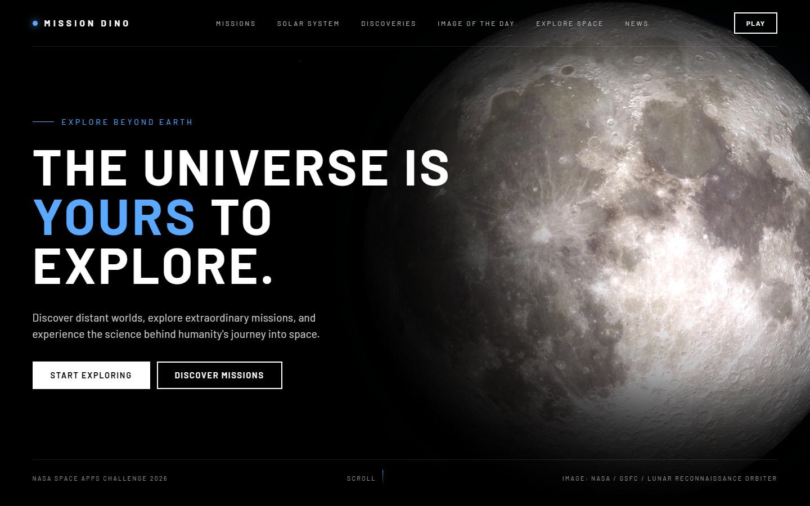

# Mission Dino

**Design, launch and operate your own space mission.** A NASA Space Apps Challenge 2026 entry for the *Space Mission Design Game* challenge.



## What it is

Mission Dino is a browser game about the trade-offs behind real space missions. You pick a destination, build a spacecraft within a budget, pass a launch review, then keep the mission alive through solar storms, hardware failures and surprise discoveries. Every choice costs mass, power, data or money, and there is no perfect answer.

Around the game is a small space exploration site built from real NASA imagery and data.

## Features

### The game

1. **Mission team:** play alone or with up to 4 people on one screen. Each player takes a role (Mission Lead, Spacecraft Engineer, Science Lead, Comms & Ops) with its own goal.
2. **Choose a destination:** Earth Watch (easy), Red Planet Mapper (medium) or Giant Planet Explorer (hard), each with its own budget, science target and duration.
3. **Mission briefing:** objectives, resources, environmental conditions, constraints and risks for the mission you picked.
4. **Spacecraft design:** choose the orbit, structure, power, battery, computer, pointing, comms, instruments and launch vehicle, with a live dashboard for mass, power, cost, data, lifetime and science.
5. **Launch readiness review:** a review board blocks launches that are too heavy, over budget or missing instruments.
6. **Mission control:** respond to random operations events. Each choice shows what is at stake, and the projected results update live.
7. **Mission report:** success, partial success or failure, with score, achievements, target-vs-actual charts, an explanation of why it went that way, a comparison with a real NASA mission and a leaderboard kept on this device.

You can share a spacecraft design as a link.

### The site

- **Landing page:** a full-screen Moon photo from the Lunar Reconnaissance Orbiter, featured missions, a solar system overview, recent discoveries and the NASA Astronomy Picture of the Day.
- **Explore space:** all eight planets with NASA photos and facts, a featured Pluto discovery, a size chart drawn to scale, a discovery timeline and a gallery of famous telescope images.
- **Space news:** hand-picked stories plus live feeds of discoveries, mission updates and space science from the NASA Image and Video Library, with Load more.
- Responsive on desktop, tablet and phone, with reduced-motion support.

## The science inside

The game uses simplified versions of real spacecraft engineering:

- **Tsiolkovsky rocket equation:** every kilogram of hardware needs extra fuel to reach orbit.
- **Inverse-square sunlight:** solar panels make about 43% of their Earth power at Mars and under 4% at Jupiter.
- **Link budgets:** the farther away you are, the less data you can send home.
- **Radiation:** shielding and radiation-hardened computers decide how long electronics survive.

Values are simplified for learning, and the report compares your spacecraft with Landsat 9, Mars Reconnaissance Orbiter and Juno.

## Run it

It's a single HTML file with no build step and no dependencies.

1. Download or clone the repo.
2. Open `index.html` in a modern browser.

Photos and live feeds load from NASA, so you need an internet connection. If they can't be reached, the page shows built-in fallbacks.

To serve it locally instead:

```bash
python -m http.server 8765
```

Then open http://localhost:8765.

### Self-check

`check.js` runs the game logic in Node, with no browser needed. It tests:

- share-link validation;
- name escaping;
- the briefing for each mission;
- a full run through every operations event to the report;
- the explore and news pages.

```bash
node check.js index.html
```

## Data and credits

- **Images:** NASA Image and Video Library (public domain), including LRO, Artemis II, Perseverance, Juno, Cassini, Voyager, New Horizons, Hubble and James Webb imagery. Each image links to its NASA page.
- **APIs:**
  - [NASA APOD API](https://api.nasa.gov/) for the picture of the day. It uses the shared demo key, and the result is cached for the day.
  - [NASA Image and Video Library API](https://images.nasa.gov/docs/images.nasa.gov_api_docs.pdf) for the news feeds.
- **Facts:** NASA Planetary Fact Sheet and NASA mission pages.
- This project is not affiliated with or endorsed by NASA.

## AI assistance

Code was written with help from an AI assistant (Claude). Game design, testing and data choices are by the team.
